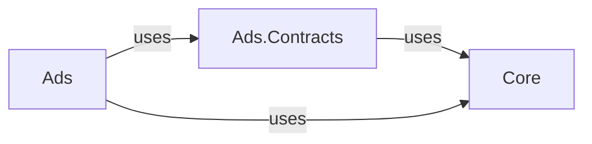

<!-- GENERATED by ./tools/test-gate.sh graph --write (or Unity: Tools > Game > Regenerate System Map) · do not edit · stale = ARCH090 -->
# Feature: Ads

Hand-written intent and invariants: `Assets/_Game/Features/Ads/README.md`. Back to the [system map](../overview.md).

## Dependencies (1 hop)



| | |
|---|---|
| Uses | Core |
| Used by | - |
| Implements | - |
| Implemented by | - |
| Public face | AdsInstaller, IAdsService |
| Vendors | demo-ads, unitask |
| Assets (Public/Private) | 0/0 |
| Tests | 0 |

## Constructor injection (L3)

```text
Ads (constructor injection)
  
```
