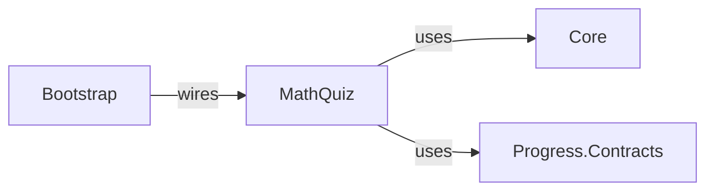
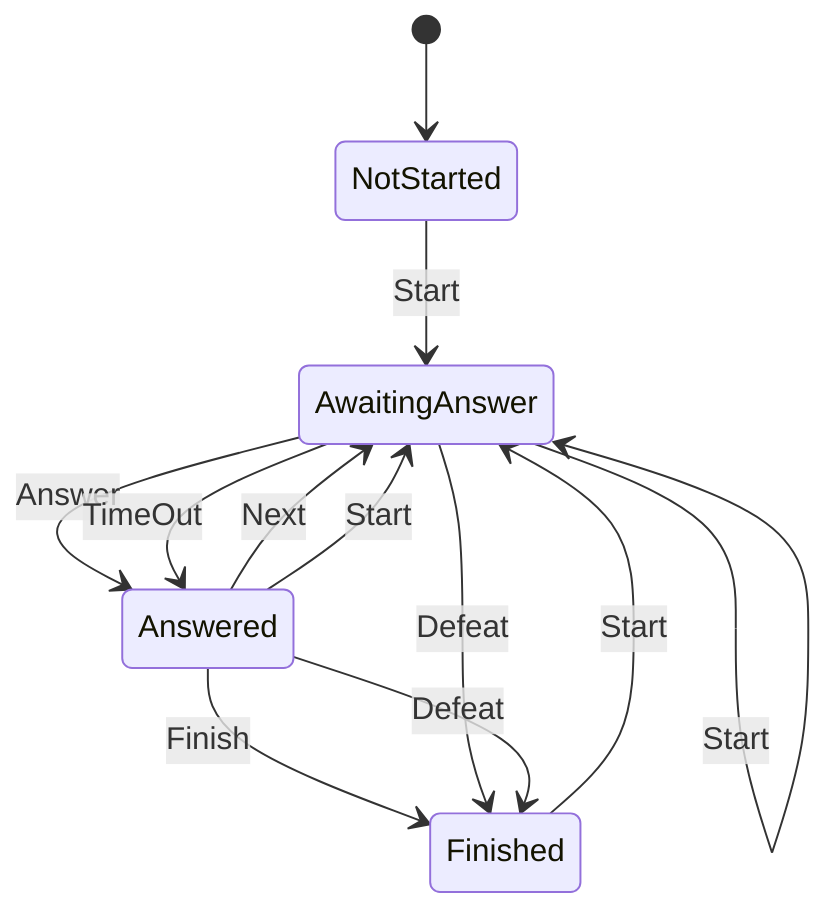

<!-- GENERATED by ./tools/test-gate.sh graph --write (or Unity: Tools > Game > Regenerate System Map) · do not edit · stale = ARCH090 -->
# Feature: MathQuiz

Hand-written intent and invariants: `Assets/_Game/Features/MathQuiz/README.md`. Back to the [system map](../overview.md).

## Dependencies (1 hop)



| | |
|---|---|
| Uses | Core, Progress.Contracts |
| Used by | Bootstrap |
| Implements | - |
| Implemented by | - |
| Public face | MathQuizAssets, MathQuizInstaller, MathQuizModule, QuizConfigAsset, QuizView |
| Vendors | unitask |
| Assets (Public/Private) | 0/0 |
| Tests | 99 |

## State machine: QuizSession.Transitions (QuizState)

Generated from the `Transition<QuizState>` table that the code enforces at runtime.



## Constructor injection (L3)

```text
MathQuiz (constructor injection)
  Arena <- ArenaConfig, IRandomStreams   [Logic]
  ArenaEvent <- ArenaEventKind, int   [Logic]
  MathQuizModule <- QuizPresenter, QuizView   [Unity]
  Question <- int, int, IReadOnlyList<int>   [Logic]
  QuestionGenerator <- QuizConfig, IRandomStreams   [Logic]
  QuizBattle <- QuizConfig, ArenaConfig, IRandomStreams, IBestScoreService, IQuestionGenerator, IGameLogger   [Logic]
  QuizCommand <- QuizCommandKind, int   [Logic]
  QuizPresenter <- QuizBattle, IQuizView, IGameClock, IFrameSource, Lifetime   [Logic]
  QuizSession <- QuizConfig, IQuestionGenerator, IBestScoreService   [Logic]
```
