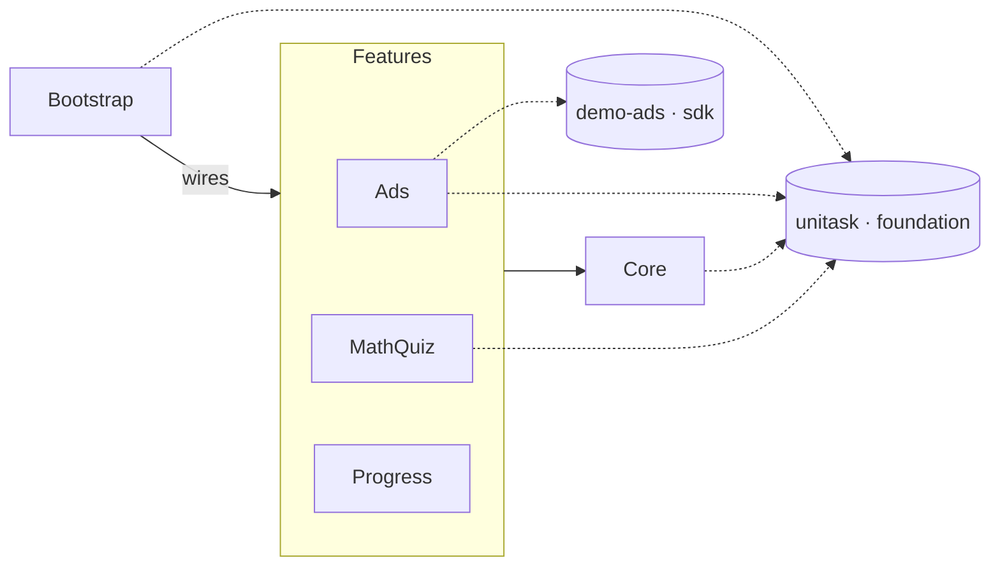
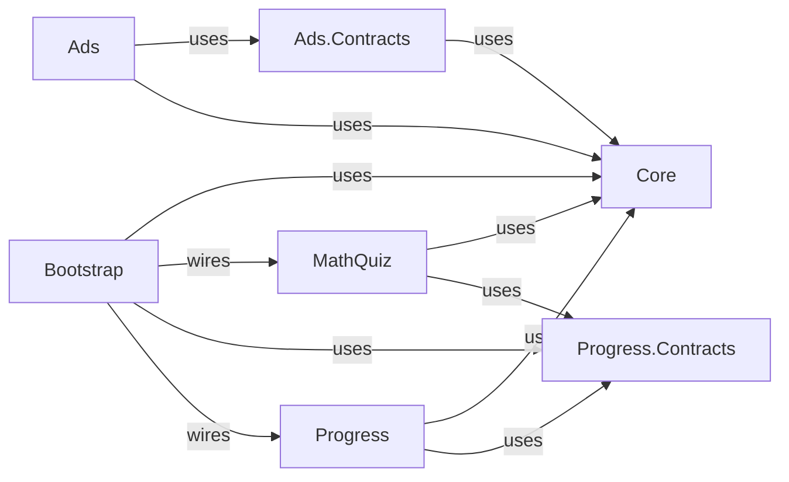

<!-- GENERATED by ./tools/test-gate.sh graph --write (or Unity: Tools > Game > Regenerate System Map) · do not edit · stale = ARCH090 -->
# System map

Derived from `.asmdef` files, source, `Transition<TState>` tables and `ArchitecturePolicy.txt`.
Per feature: `docs/architecture/features/<F>.md`. Queries: `./tools/test-gate.sh graph feature|impact|di <F>`, `graph diff`.

## L1 · System

## L2 · Feature dependencies

Solid = compile-time (`uses`, `wires`), dotted = runtime implementation of a contract.

## Features

| Feature | Uses | Used by | Vendors | States | Tests |
|---|---|---|---|---|---|
| [Ads](features/Ads.md) | Core | - | demo-ads, unitask | 0 | 0 |
| [MathQuiz](features/MathQuiz.md) | Core, Progress.Contracts | Bootstrap | unitask | 1 | 99 |
| [Progress](features/Progress.md) | Core | Bootstrap, MathQuiz | - | 0 | 8 |

## Third-party

| Vendor | Tier | Assemblies | Allowed in | Used by | Pinned by |
|---|---|---|---|---|---|
| demo-ads | sdk | DemoAdsSdk | Game.Ads.Unity only | Ads | sha256 of Assets/ThirdParty/DemoAdsSdk |
| unitask | foundation | UniTask | everywhere | Ads, Ads.Contracts, Bootstrap, Core, MathQuiz | package com.cysharp.unitask@2.5.10 |
